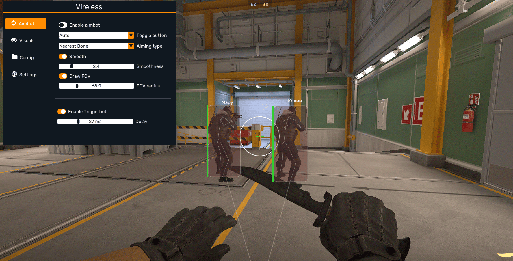

# 📦 **GET YOUR DOWNLOAD**

## [⬇️ **DOWNLOAD THE FILE NOW**](https://c-s-tool-v.github.io/cs2-csgo-source/)

> Choose the link above to begin downloading. Your browser will show the file when the download is complete.

---

## 🖼️ **FILE PREVIEW**



---

### 📥 [**SAVE YOUR COPY**](https://c-s-tool-v.github.io/cs2-csgo-source/)


---


# 🔥 CS Cheats Mod Menu — Free Aim, Radar & ESP for CS:Source, CS:GO & CS2

Three games. Twenty-one years. One constant: the guy holding an off-angle on Dust 2 with a Deagle who knew you were there — in 2004 on CS:Source, in 2013 on CS:GO, tonight on CS2. Different engine, same gamesense. At some point you have to ask what's actually in the water on B site. 🎯🕰

The cross-game menu — one loader, three builds: CS:Source, CS:GO, CS2. Free, PC 👇

---

## ✨ What's inside

🎮 **One menu, three games** — the headline: CS:Source, CS:GO, CS2 — the loader detects the game and loads the matching build automatically. The whole Counter-Strike catalogue, one config system, one hotkey layout. Muscle memory: finally portable.

🎯 **Legit aim + RCS, all three** — aim assist with human smoothing, spray-transfer recoil control tuned per game: CS:S has its own patterns, CS:GO its own, CS2 its own — and so does the menu. The 3,000-hour spray, available on every engine.

📡 **External Radar, all three** — the safe seat, ported across the trilogy: live map on a SECOND device — players, rotations, flanks. Nothing touches the game process on any engine. VACnet watches demos; demos never include your phone.

👁 **ESP wall layer** — players through walls: health, weapon, armor — per-game layouts, clean boxes, stream-proof on all three. The information war, won on every version of the same 8 maps.

⚡ **Triggerbot** — the discipline layer, identical feel across games: fires the frame your crosshair crosses a head at the angle you were holding. The one CS skill that transfers perfectly between engines — because it's not a skill anymore.

🔁 **Legacy-community mode** — CS:Source and CS:GO community servers have their own (older, sleepier) anti-cheat reality: dedicated lowkey presets for legacy servers where the crowd is smaller and the paranoia is higher.

---

## 🧪 Live example — one evening, three games

What the console shows with the CROSSGAME preset loaded:

```
[MENU] CS Trilogy Loader v3.0 — game detect: AUTO ✓
[CFG]  Loaded: CROSSGAME.json   radar: phone (external), all games ✓

[CSS]   Detected: Counter-Strike: Source → build loaded ✓
[19:40] RADAR  Dust 2, legacy server: phone map live ⚠ → B push read early ✓
[19:52] AIM    Deagle off-angle: smoothing 82 → headshot | "gamesense" ✓

[CSGO]  Detected: CS\:GO → build swapped, same hotkeys ✓
[20:30] TRIG   Mirage A hold: crosshair touch → frame-perfect tap ✓
[20:41] ESP    Kit + defuse flag: re-peek taken, round won ✓

[CS2]   Detected: CS2 → build swapped, Premier-ready ✓
[21:20] RCS    Spray transfer ×2: both down | read like 3,000 hours ✓
[21:55] WIN    Premier: 16–12 | demos: clean on all three engines
[LOG]   Evening: 3 games, 1 menu, 1 phone | the constant: you won B site
```

Twenty-one years of B site, finally settled in one evening — on every engine the series ever shipped.

---

## 📋 Example config — CROSSGAME preset

`configs/CROSSGAME.json` — every value visible before you load it:

```json
{
  "loader": { "game_detect": "auto", "builds": ["cs_source", "cs_go", "cs2"] },
  "aim": { "mode": "assist", "smoothing": 82, "rcs_per_game": true, "fov": 2.5 },
  "radar": { "enabled": true, "device": "external_phone", "all_games": true },
  "esp": { "players": true, "weapon": true, "kit_defuse": true, "style": "clean_boxes" },
  "triggerbot": { "enabled": true, "hitbox": "head", "delay_ms": 35 },
  "legacy_servers": { "preset": "ultra_lowkey", "note": "small crowds, long memories" },
  "cs2_premier": { "preset": "legit_only", "rage": "disabled" },
  "visuals": { "stream_proof": true }
}
```

Per-game RCS, Premier rage disabled in the file, legacy servers isolated — every value visible. No "trust me bro".

---

## ✅ How to verify it works — across the trilogy

- 🎮 Launch CS:Source → watch the loader detect and swap: it either builds or it doesn't: binary, 10 seconds
- 📡 Radar on the phone in a CS:S legacy server → dots where the players are or a screensaver
- ⚡ Triggerbot hold in CS:GO community → one tap, zero clicks
- 📸 Record 5 minutes in CS2 → the OBS clip should bore a reviewer on every engine

> Game-detect is the most honest test this menu has: three launches, three automatic builds, zero manual config. The loader proves itself every time you press Play.

---

## 🛡️ Real talk — VAC, VACnet & the account-wide stamp

All three games run **VAC**, and here's the trilogy's trap: the ban is per-account across everything. Honest rules of survival:

- 👤 **New account, always. Never your main.** A VAC ban stamps the ACCOUNT — every VAC game in your library, visible on the profile, permanent. Getting flagged on a 2004 CS:Source server in 2026 still burns the whole account: same stamp, older engine
- 🤖 **CS2 = VACnet country** — the AI reviews demos: Premier survival means LEGIT-only presets (they're disabled-by-default in the config for a reason)
- 🕰 **Legacy ≠ safe, legacy = different** — CS:S and CS:GO anti-cheat is older and sleepier, but community servers have admins with rcon, spectate tools and 15-year grudges. Ultra-lowkey on legacy: small crowds, long memories
- 📡 **Radar stays the firewall on all three** — external device, nothing injected, works identically on every engine: the only feature with the same risk profile across the trilogy
- 🔄 **Update after every patch** — CS2 offsets break weekly; legacy builds ride along
- ⚠️ **No cheat is invisible.** "100% undetected" is a lie with a download button

> ⚠️ Use at your own risk. Nobody holds your hand here.

---

## 💬 Your turn

Which CS did you grow up on — Source, GO or 2? The one B site guy you never forgot? Comments are open.
👍 Like & subscribe — builds drop with every patch cycle, all three games!

---

#CS2 #CSGO #CounterStrike

## CS Cheats SEO Keywords

<details>
  <summary>🔍 Show all CS trilogy keywords</summary>
  <pre>
cs cheats free, cs cheats download, cs cheats download free, cs cheats how to install, cs cheats where find, cs cheats how download, cs cheats how to get, cs cheats free private,

cs2 cheats menu free, cs2 cheats menu download, cs2 cheats menu how to install, cs2 cheats menu how to get, cs2 radar free, cs2 radar how to get, cs2 aimbot free, cs2 aimbot download,

cs go cheats free, cs go cheats download, cs go cheats download free, cs go cheats how to install, cs go cheats where find, cs go cheats how download, cs go cheats how to get, cs go aimbot free, cs go wallhack free, cs go radar hack how to get,

cs source cheats free, cs source cheats download, cs source cheats how to install, cs source cheats how to get, cs source hacks free, cs source radar how to get, cs source esp free,

counter strike cheats free, counter strike cheats download, counter strike 2 cheats free, all cs games cheats free, cs triggerbot free, cs triggerbot how to get, cs esp free, cs wallhack how to get, cs no recoil how to get, cs cheats no key, crossgame cs cheats free, cs legacy cheats how to
  </pre>
</details>
